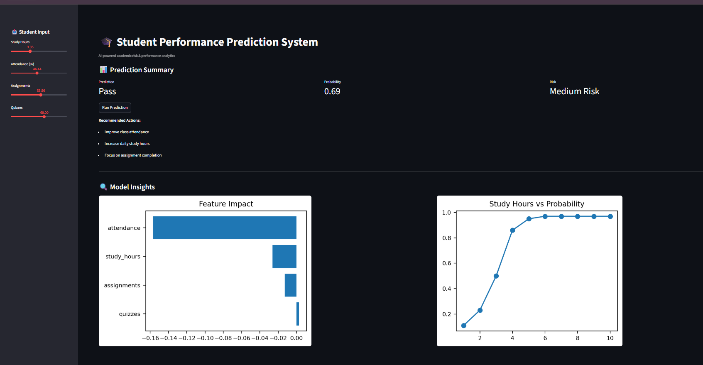
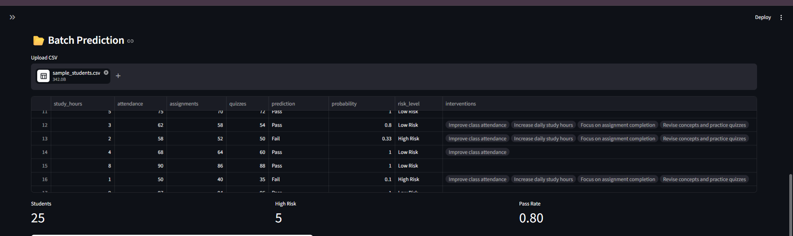
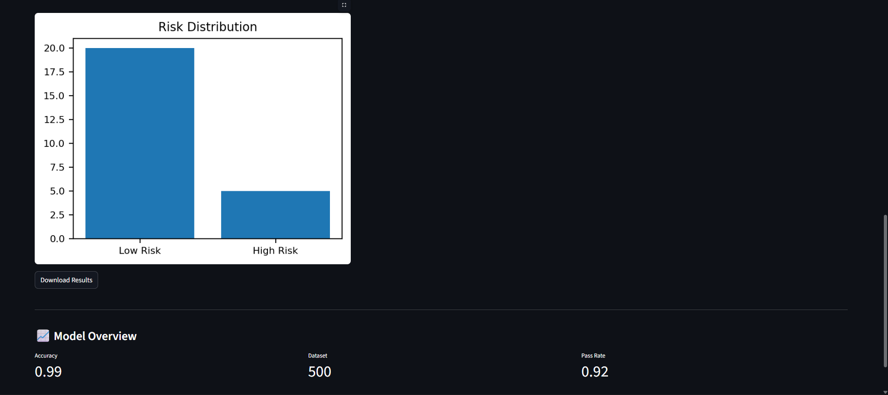

# 🎓 Student Performance Prediction System

An end-to-end **Machine Learning + Explainable AI dashboard** that predicts student academic performance, identifies at-risk students, and provides actionable interventions.

---

## 🚀 Project Overview

This system analyzes student data such as:
- Study hours
- Attendance
- Assignment scores
- Quiz performance

…and predicts:
- ✅ Pass / Fail outcome  
- 📊 Probability of success  
- ⚠️ Risk level (Low / Medium / High)  
- 🧠 Personalized intervention suggestions  

---

## 🎯 Key Features

- 📊 **Real-time Prediction**
- ⚠️ **Risk Scoring System**
- 🧠 **SHAP Explainability (Feature Impact)**
- 📂 **Batch Prediction via CSV Upload**
- 📈 **Risk Distribution Analytics**
- 🔍 **What-if Analysis (Study Hours vs Outcome)**
- 🎛️ **Interactive Streamlit Dashboard**
- ⚡ **FastAPI Backend (Optional API Support)**

---

## 🧠 Tech Stack

- Python
- Pandas, NumPy
- Scikit-learn (Random Forest)
- SHAP (Explainable AI)
- Streamlit (Dashboard)
- FastAPI (API)
- Matplotlib

---

## 📂 Project Structure


Student-Performance-Prediction/
│
├── data/
├── src/
├── models/
├── images/
├── app.py
├── main.py
├── requirements.txt
└── README.md


---

## ⚙️ Installation & Setup

```bash
git clone 
cd Student-Performance-Prediction

python -m venv venv
venv\Scripts\activate   # Windows

pip install -r requirements.txt
▶️ Run the Project
1. Generate Data
python data/generate_data.py
2. Train Model
python src/train.py
3. Run Dashboard
streamlit run app.py
4. (Optional) Run API
uvicorn main:app --reload
📊 Sample Input (CSV)

Upload this format in dashboard:

study_hours,attendance,assignments,quizzes
5,80,70,60
3,60,50,40


## 📊 Dashboard


## 📈 Prediction Output


## 🔍 Insights & Explainability



🧠 How It Works
Student data is collected
Data is processed and fed into ML model
Model predicts performance
SHAP explains feature importance
System generates risk level + interventions

💡 Use Cases
🎓 Universities → Identify at-risk students
📚 EdTech → Personalized learning paths
🏢 Corporate L&D → Training performance tracking

🎯 Future Improvements
PDF report generation
Email alert system
Model retraining pipeline
Cloud deployment (AWS/GCP)


👨‍💻 Author

Sahil
Engineering Student | Aspiring Data Scientist